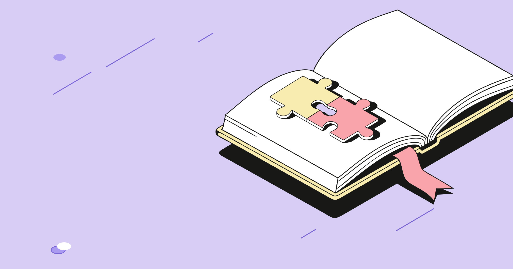
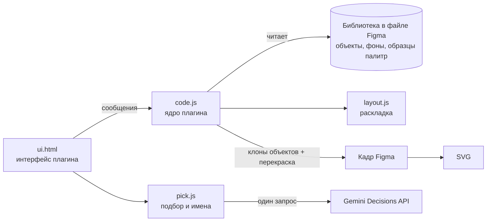

# Сборщик иллюстраций (плагин Figma)

Плагин собирает векторные иллюстрации из готовых объектов библиотеки. Сами объекты не меняются: они клонируются как есть, меняются только положение в кадре и цвета палитры.

## Что умеет

- **По смыслу.** Человек вводит метафору или заголовок ("Момент эврики: откуда приходят прорывные продуктовые идеи"), ИИ выбирает 2-3 подходящих объекта, плагин раскладывает их в кадре и даёт 4 варианта на выбор.
- **ИИ выбирает лучший вариант.** Кнопка "ИИ выбрать лучший" отправляет превью всех 4 вариантов в Gemini как картинки. Модель смотрит на них как арт-директор (баланс сцены, перекрытия, обрез краем, читается ли смысл заголовка), отмечает лучший и показывает уверенность в процентах у каждого варианта. Последнее слово остаётся за человеком.
- **По объектам.** Человек сам нажимает на нужные объекты и у каждого выбирает, будет он главным или фоном. Первый в списке становится героем сцены.
- **Перекраска.** Выделите готовые кадры на холсте и нажмите на палитру, окно заранее пишет, сколько кадров перекрасится. Есть три встроенные палитры (сиреневая, персиковая, мятная), свою можно собрать из выделения в Figma.
- **Экспорт SVG.** Чистый вектор без растра. Если вставить его обратно в Figma, он остаётся векторами.
- **Форматы:** квадрат 1000 x 1000, обложка 1200 x 630, вертикальный 800 x 1200 или свой размер. Размер объектов L или S выбирается сам (S для небольших кадров и сцен из 4 и больше объектов), можно переключить вручную.
- **Стиль раскладки:** собранно, со смещением, под заголовок (одна сторона кадра остаётся свободной для текста).
- Если Gemini не ответил за 30 секунд или нет сети, объекты подбираются по словам заголовка без ИИ, и окно об этом пишет.

## Примеры

| | | |
|---|---|---|
|  |  |  |
| "Всегда на связи: как поддержка отвечает клиентам за 30 секунд" | "Новый выпуск подкаста о карьере в IT" | "Учиться на чужих ошибках: разбор провальных запусков" |
| телефон и наушники, собранно, персиковая, 1200 x 630 | наушники, книга фоном, со смещением, мятная, 1000 x 1000 | книга и пазл, под заголовок, сиреневая, 1200 x 630 |

Объекты подобраны ИИ по заголовку. SVG и PNG каждого кадра лежат в [examples/](examples/README.md). В экспортированных SVG нет ни одного цвета вне выбранной палитры и нет растра.

## Как устроено

- `src/ui.html` отвечает за интерфейс и обменивается сообщениями с `src/code.js`. Запросы в сеть идут из интерфейса, потому что код в песочнице Figma их делать не может.
- `src/code.js` читает библиотеку прямо из открытого файла Figma: объекты размеров L и S, их фоновые версии, палитры (группы из 8 образцов цвета). В коде нет id узлов: объекты узнаются по имени, а если имени нет, по форме. Новые объекты в библиотеке подхватятся без правки кода. Дальше ядро клонирует объекты, красит их по слотам палитры, кладёт декор фона и собирает кадр.
- `src/layout.js` раскладывает объекты. Это чистая функция, она работает и в node без Figma. Внутри 18 шаблонов, снятых с кадров дизайнера: где стоит крупный фоновый объект, где подставка, где мелкий акцент, сколько объекта срезает край кадра, кто кого перекрывает. Под набор объектов подбираются близкие шаблоны и сдвиги вдоль изометрических осей, кандидаты проходят проверки (заполнение кадра, видимость мелких объектов, порядок слоёв по глубине, декор не прячется под объектами). Из лучших берутся 4 разных варианта. Масштаб объектов всегда 1:1, как у дизайнера.
- `src/pick.js` подбирает объекты по смыслу одним запросом в Gemini Decisions API: вопрос "какой предмет лучше передаёт смысл заголовка" с объектами библиотеки в качестве вариантов. Из вероятностей берутся герой и 1-2 второстепенных объекта. Если уверенность низкая, плагин пишет, что подходящего объекта нет, и собирает ближайшее по смыслу.
- `build.mjs` склеивает `layout.js` и `code.js` в `dist/code.js` и собирает `dist/ui.html`.

## Как подготовить файл Figma

Плагин работает с библиотекой, которая лежит в открытом файле, а не с библиотеками компонентов команды. При запуске он просматривает все страницы файла и ищет:

- **Секции "Размер L" и "Размер S"** (тип Section, название содержит "Размер L" или "Размер S"). Достаточно одной из них.
- **Объекты:** группы прямо внутри секции, по группе на объект. Имя слоя ("Книга", "Телефон" и так далее) помогает узнать объект, но необязательно: безымянные объекты плагин узнаёт по форме или предлагает распознать по картинке.
- **Фоновые версии объектов:** группы ниже текстового заголовка со словом "Фоновые" в той же секции.
- **Палитры:** группы из 8 цветных прямоугольников в две колонки, слева цвета фона, справа цвета объектов, как в образцах дизайнера.
- **Фоны с декором:** рамки со словом "фон" в названии, залитые цветом фона палитры. Конфетти и линии из них плагин кладёт в кадр.

Файл с библиотекой из задания уже устроен так, его можно открыть и сразу запускать плагин. Готовые кадры появляются на текущей странице. Чтобы собирать иллюстрации в другом файле, скопируйте туда секции "Размер L" и "Размер S" целиком. Если библиотеки в файле нет, окно плагина об этом пишет. Свои палитры и распознанные имена объектов плагин хранит в самом файле, исходные объекты не меняет.

## Как собрать и поставить

1. Положить в корень проекта `.env` со строкой `GEMINI_API_KEY=...`. Ключ необязателен: без него в настройках плагина есть поле для своего ключа, сценарий "По объектам" работает без сети, а "По смыслу" подбирает объекты по словам заголовка.
2. Выполнить `node build.mjs`.
3. В Figma Desktop: Plugins, Development, Import plugin from manifest, выбрать `dist/manifest.json`.
4. Открыть файл с библиотекой объектов и запустить "Сборщик иллюстраций".

## Как проверялось качество

Критерии записаны до начала работы, каждая проверка автоматическая, на 33 тестовых кадрах: 10 наборов объектов в 3 форматах и 3 кадра с мелкими объектами и сценами из 4-5 объектов.

| Что проверяем | Результат |
|---|---|
| В итоговом SVG нет цветов вне палитры | 33 из 33 кадров |
| Объекты не искажены: та же геометрия, масштаб 1:1 | 33 из 33 |
| SVG вставляется в Figma векторами, без растра | 33 из 33 |
| Порядок слоёв по глубине без ошибок | 33 из 33 |
| Раскладка похожа на кадры дизайнера (заполнение, видимость, перекрытия) | 30 из 33 |
| ИИ выбирает правильного героя на 20 заголовках, которые не участвовали в настройке | 19 из 20, одинаково в 3 прогонах |
| Названия объектов: синонимы, падежи, опечатки, английские слова | 25 из 25 |

## ИИ-инструменты

- **Claude Code:** планирование, критерии, код и замеры.
- **Gemini через Antigravity:** разбор раскладки кадров дизайнера, выжимки по большим файлам.
- **Gemini Decisions API** внутри плагина: подбор объектов по смыслу одним запросом и выбор лучшего из 4 вариантов по картинкам. Сравнивался с обычным текстовым ответом `gemini-3.5-flash-lite`: тот реже выбирал одного и того же героя на повторных запусках.
- **[Mokido](https://github.com/kolganovr/mokido)**, мой MCP-мост между Claude и Figma: через него шли все замеры в живом файле и сборка примеров.

## Известные ограничения

- Пока идёт сборка, окно плагина нельзя двигать: Figma выполняет код плагина в одном потоке. Прогресс "Собираю вариант N из 4" при этом обновляется.
- Подсказка "нет подходящего объекта" иногда появляется зря, примерно на четверти обычных заголовков. Сборку она не блокирует.
- Сцены только из мелких объектов (монета, ручка, пазл) заполняют кадр слабее, чем у дизайнера: объекты не масштабируются, поэтому плагин предупреждает "объектов мало для такого кадра".

## Файлы

- `src/` код плагина, `build.mjs` сборка
- `examples/` три примера в SVG и PNG
